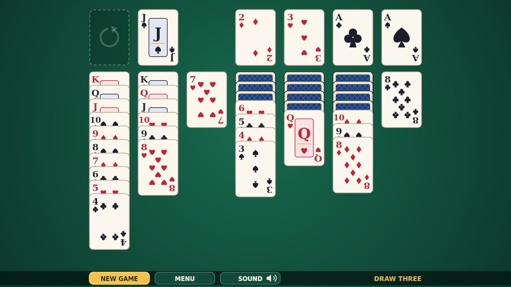
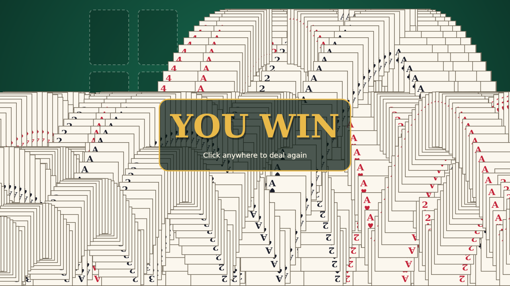

# Cascade

Cascade is Klondike solitaire on a deep green felt table: seven columns of
cards, a stock to turn, and four foundations to build from Ace to King, one
suit each. It is unhurried and untimed. There is no score and no clock, just
you, the deal, and the buried cards waiting to be freed.

Play is all pointer. Drag a face-up card, and every card below it comes along,
onto a column one rank higher in the other color; the pile that will take it
lights up as you carry it over. Only a King fills an empty column. Click the
stock to turn three cards onto the waste, where only the front one is in play,
and click the empty slot to gather the waste back for another pass. When a card
can go home, double-click it and it jumps onto its foundation. A mouse and a
touchscreen work exactly the same, and the menus answer the keyboard too.

This is the Draw Three game, so the stock is a puzzle of its own: the order of
each pass matters, and a well-timed move off the waste can open up the whole
next pass.

Then the payoff. The moment the last King lands, the table gives way. Card
after card launches off the foundations, arcs under gravity, bounces along the
bottom of the table, and leaves a trail of itself behind, until the felt is
buried under overlapping cards and the last one drifts off the edge. Click
anywhere and a fresh deal is waiting.

